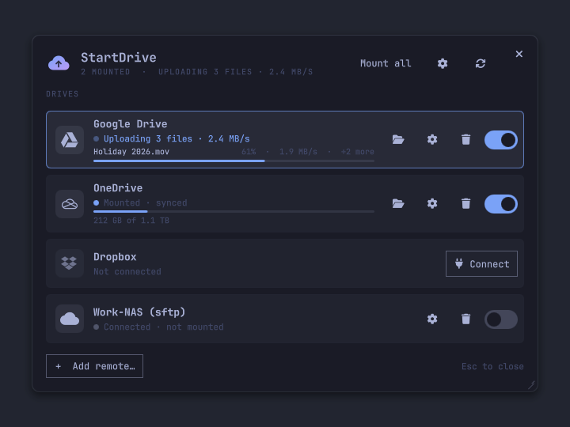
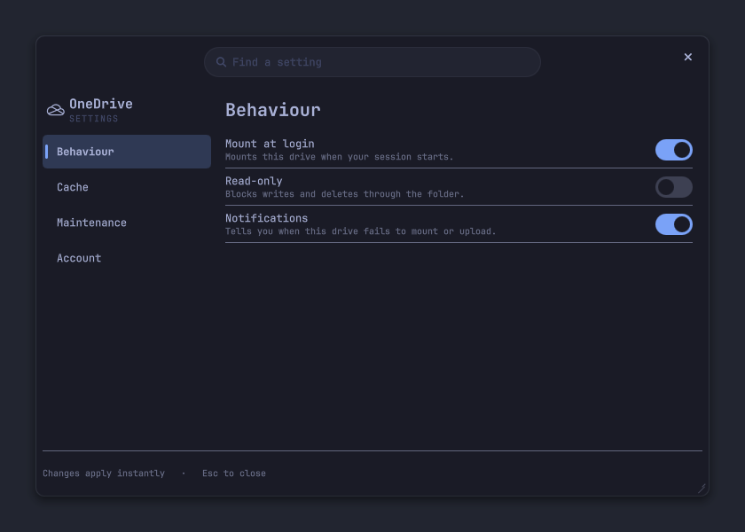
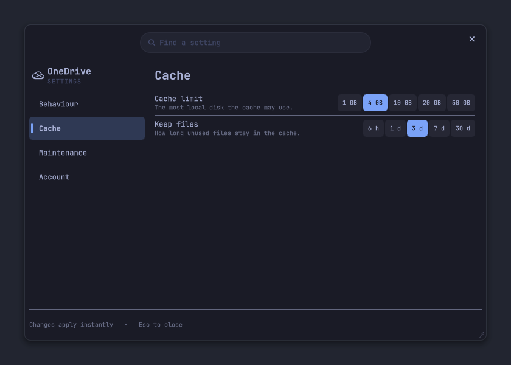
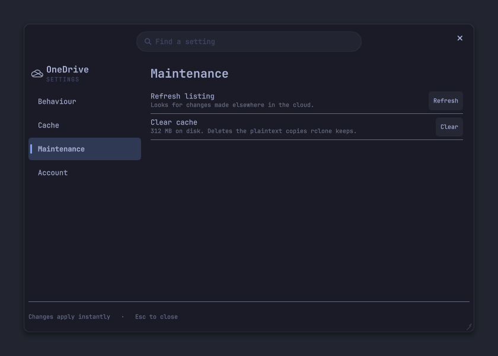
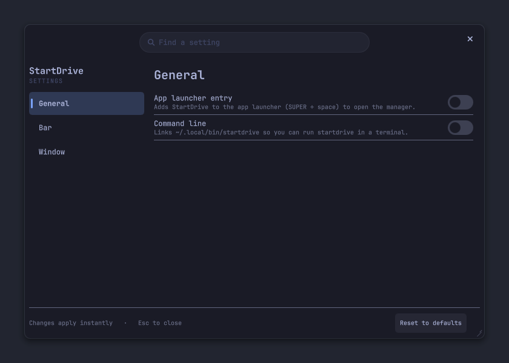

<p align="center">
  <picture>
    
  </picture>
</p>

<h1 align="center">StartDrive</h1>

<p align="center">
  <b>Your cloud drives as folders, for Omarchy.</b><br>
  Google Drive, OneDrive, Dropbox and any other rclone backend, mounted under <code>~/Cloud</code>
  with live upload activity, cache controls and per-drive settings, all a click away.
</p>

<p align="center">
  <a href="#install">Install</a> ·
  <a href="#tour">Tour</a> ·
  <a href="#configure">Configure</a> ·
  <a href="#commands">Commands</a> ·
  <a href="#security">Security</a> ·
  <a href="#update-and-remove">Update and remove</a> ·
  <a href="#contributing">Contributing</a>
</p>

> **Omarchy 4.5:** StartDrive is compatible with the windowed mode coming in Omarchy 4.5.

## Install

```sh
omarchy plugin add https://github.com/bmaltais/StartDrive.git --enable
```

The first time it runs, a settings window offers the recommended set: an **app launcher entry** (so SUPER + space finds it), a **command line** (`startdrive` in a terminal) and a **cloud icon on the bar**. Take them all with **Enable recommended**, or pick. The first time you connect a drive, `rclone` and `fuse3` are installed with `omarchy pkg add` (one sudo prompt, the only privileged step). Everything else (`secret-tool`, `gum`, `jq`, `curl`) comes with Omarchy.

```
~/Cloud/GoogleDrive
~/Cloud/OneDrive
~/Cloud/Dropbox
```

## Tour

### The manager



- **One row per drive.** A status dot and line: not connected, mounting, mounted, synced, uploading (with the speed) or failed. A mounted drive also shows a storage meter, and while files are on their way, the file, its progress and how many more are waiting.
- **A switch to mount.** A folder button opens the drive in your file manager, a cog opens its settings, a bin forgets the account. Click anywhere else on the row for its main action: connect, open the folder, or mount.
- **Sync status.** Uploads are written to a local cache first and sent in the background, so the manager tells you when they are still on their way. "All synced" means it is safe to shut down.
- **Everything at once.** With more than one drive connected, **Mount all** (or **Unmount all**) does it for every drive.
- **Any other remote.** **Add remote…** runs rclone's questionnaire in a terminal for any other backend (SFTP, WebDAV, S3, B2 ...). A remote named with letters, digits, `-` or `_` then shows up as a drive.

### The bar icon

An optional cloud on the Omarchy bar, on by default, that opens the manager. It turns into an **upload cloud** while files are moving and into a **red alert cloud** if a mount or an upload fails, so you can see at a glance whether it is safe to shut down. Right click looks at the drives again. Switch it off under **Bar** in the settings.

### Keyboard

`Up`/`Down` (or `j`/`k`) move, `Enter` does a row's main action, `m` mounts or unmounts, `o` opens the folder, `s` opens its settings, `f` forgets the account, `a` mounts or unmounts all, `r` looks again, `n` adds a remote. Escape closes the topmost window.

### A drive's settings

<table>
  <tr>
    <th>Behaviour</th>
    <th>Cache</th>
    <th>Maintenance</th>
  </tr>
  <tr valign="top">
    <td></td>
    <td></td>
    <td></td>
  </tr>
</table>

The cog opens a drive's settings, in four pages: **Behaviour**, **Cache**, **Maintenance** and **Account** (forget the drive, or give Google Drive its own key). Search them from the box at the top.

### The app's settings



The gear in the manager's header opens the app's own settings: the launcher entry, the command line, the bar icon, and whether the windows remember their size and position. Drag a window by its top strip and resize it from the bottom-right corner.

### Colours

Colours and fonts follow the current Omarchy theme live, in the windows and in the bar icon.

## Configure

Changes apply as you make them, from a drive's settings.

- **Behaviour.** Mount at login, read-only to block writes and deletes through the folder, and notifications when a drive fails to mount or upload.
- **Cache.** Choose how much disk the cache may use (1 to 50 GB) and how long unused files stay (6 hours to 30 days).
- **Maintenance.** Refresh the directory listing when something changed in the cloud, or clear the cache to delete the plaintext copies rclone keeps. Clearing is refused while uploads are pending, because those files exist only in the cache.

A change to a mounted drive is applied at once if nothing is uploading, and at the next mount otherwise.

### Settings files

Each drive's settings are saved in `~/.config/startdrive/<remote>.env`, as the rclone variables the mount reads, which you can also edit by hand:

```sh
RCLONE_VFS_CACHE_MAX_SIZE=10G
RCLONE_VFS_CACHE_MAX_AGE=72h
RCLONE_READ_ONLY=false
```

Every setting, its default and accepted values, the `startdrive set` command, the app's own settings, and when a change applies are in [docs/SETTINGS.md](docs/SETTINGS.md).

## Commands

Run these with `omarchy-shell io.github.bmaltais.startdrive <command>`, for instance from a key binding:

| Command | Does |
|---|---|
| `open`, `toggle` | Shows the manager, or hides it if it is showing |
| `close` | Hides it |
| `settings ID` | Shows one drive's settings (`google`, `onedrive`, `dropbox`, or `r-<name>`) |
| `setup` | Shows the app's settings |
| `state` | Prints the drives and their activity as JSON |
| `refresh` | Re-reads the state |
| `mount ID`, `unmount ID` | Mounts or unmounts a drive |
| `mountAll`, `unmountAll` | Does it for every connected drive |
| `connect ID` | Starts the sign-in in a terminal |

The helper script works on its own too, and is on your path as `startdrive` if you keep the command line setting on: `startdrive --help`.

## Security

Plugins run unsandboxed, so this one keeps its footprint small and documents it. The rclone config is encrypted with a random 256-bit key that lives only in your login keyring. Google Drive, OneDrive and Dropbox sign in with OAuth in your browser, so no password passes through the plugin. Mounts are private to your user, and the remote-control socket each mount opens sits in a `0700` directory. The full model, every dependency and privilege boundary, and the files the plugin touches are in [docs/SECURITY.md](docs/SECURITY.md).

## Update and remove

```sh
omarchy plugin update io.github.bmaltais.startdrive --yes && omarchy restart shell
```

Your drives and credentials are kept: they live in rclone's config and your keyring, not in the plugin folder. A copy installed before the rename to StartDrive moves its mounts to the new unit the first time the manager loads. Coming from a version that was only a bar panel, the cloud icon stays where it was on your bar, and the settings window opens once to offer the launcher entry and the command line.

To remove it, first forget each drive you no longer want from the manager, then:

```sh
startdrive uninstall   # add --purge to also delete the keyring key
omarchy plugin remove io.github.bmaltais.startdrive
```

`uninstall` stops the mounts and removes the systemd unit, the settings, the launcher entry, the command-line link and the shell environment file. It never touches your files in the cloud or the rclone remotes. Switch the bar icon off first, or `omarchy plugin remove` takes it off the bar.

## Contributing

See [CONTRIBUTING.md](CONTRIBUTING.md) for the development install, the checks, and the nested test session that runs the whole UI on demo drives without touching your real ones.

## License

MIT
