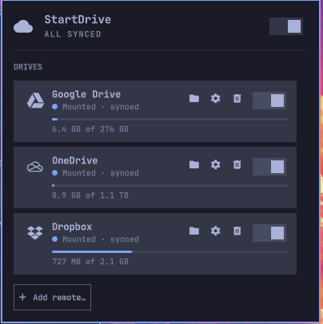
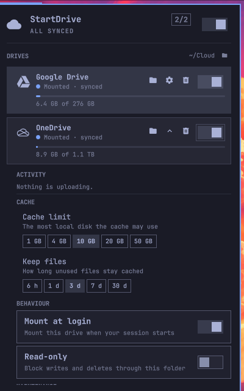

<p align="center">
  
</p>

<h1 align="center">StartDrive</h1>

<p align="center">
  <b>Your cloud drives as plain folders, from a bar widget for Omarchy.</b><br>
  Google Drive, OneDrive and iCloud Drive mounted under <code>~/Cloud</code> with rclone,
  with live upload activity, cache controls and per-drive settings.
</p>

<p align="center">
  <a href="#install">Install</a> ·
  <a href="#tour">Tour</a> ·
  <a href="#commands">Commands</a> ·
  <a href="#security">Security</a> ·
  <a href="#update-and-remove">Update and remove</a> ·
  <a href="#contributing">Contributing</a>
</p>

## Install

```sh
omarchy plugin add https://github.com/bmaltais/StartDrive --enable
```

It adds a cloud icon to the bar. The first time you connect a drive, `rclone` and `fuse3` are installed with `omarchy pkg add` (one sudo prompt, the only privileged step). Everything else (`secret-tool`, `gum`, `jq`, `curl`) ships with Omarchy.

```
~/Cloud/GoogleDrive
~/Cloud/OneDrive
~/Cloud/iCloudDrive
```

## Tour

### The panel


- **One row per drive.** A status dot and line: not connected, mounting, mounted, synced, uploading (with the speed) or failed. A mounted drive also shows a storage meter.
- **A switch to mount.** A folder button opens the drive in your file manager, a cog opens its details, a bin forgets the account. Click anywhere else on the row for its main action.
- **Sync status.** Uploads are written to a local cache first and sent in the background, so the panel tells you when they are still on their way. The bar icon turns into an upload cloud while files are moving and into an alert cloud if one fails to upload. "All synced" means it is safe to shut down.
- **Everything at once.** With more than one drive connected, the header switch mounts or unmounts them all.
- **Keyboard first.** `j`/`k` move, `h`/`l` move along a row or change a choice, `Enter` activates. `m` mounts or unmounts, `o` opens, `d` shows details, `f` forgets, `a` toggles all, `r` refreshes, Escape closes.

### Details and settings



- **Activity.** The files being transferred right now, each with its progress and speed.
- **Cache.** Choose how much disk the cache may use (1 to 50 GB) and how long unused files stay (6 hours to 30 days). Clear it to delete the plaintext copies rclone keeps. Clearing is refused while uploads are pending, because those files exist only in the cache.
- **Behaviour.** Mount at login, and read-only to block writes and deletes through the folder.
- **Maintenance.** Refresh the directory listing when something changed in the cloud, or clear the cache.

Settings are stored per drive in `~/.config/startdrive/<remote>.env`. A change to a mounted drive is applied at once if nothing is uploading, and at the next mount otherwise.

### Colours

The panel follows the current Omarchy theme live: colours, fonts and the bar's own widgets.

## Commands

Run these with `omarchy-shell io.github.bmaltais.startdrive <command>`, for instance from a key binding:

| Command | Does |
|---|---|
| `toggle`, `open`, `close` | Shows or hides the panel |
| `state` | Prints the drives and their activity as JSON |
| `refresh` | Re-reads the state |
| `mount ID`, `unmount ID` | Mounts or unmounts a drive (`google`, `onedrive` or `icloud`) |
| `mountAll`, `unmountAll` | Does it for every connected drive |
| `connect ID` | Starts the sign-in in a terminal |

The helper script works on its own too: run `~/.config/omarchy/plugins/io.github.bmaltais.startdrive/bin/startdrive --help`.

## Security

Plugins run unsandboxed, so this one keeps its footprint small and documents it. The rclone config is encrypted with a random 256-bit key that lives only in your login keyring. Google and OneDrive sign in with OAuth in your browser, and iCloud's password never appears in a command line, the environment or a log. Mounts are private to your user, and the remote-control socket each mount opens sits in a `0700` directory. The full model, every dependency and privilege boundary, and the files the plugin touches are in [docs/SECURITY.md](docs/SECURITY.md).

## Update and remove

```sh
omarchy plugin update io.github.bmaltais.startdrive --yes && omarchy restart shell
```

Your drives and credentials are kept: they live in rclone's config and your keyring, not in the plugin folder. A copy installed before the rename to StartDrive moves its mounts to the new unit the first time the panel loads.

To remove it, first forget each drive you no longer want from the panel, then:

```sh
~/.config/omarchy/plugins/io.github.bmaltais.startdrive/bin/startdrive uninstall   # add --purge to also delete the keyring key
omarchy plugin remove io.github.bmaltais.startdrive
```

`uninstall` stops the mounts and removes the systemd unit, the per-drive settings and the shell environment file. It never touches your files in the cloud or the rclone remotes.

## Contributing

See [CONTRIBUTING.md](CONTRIBUTING.md) for the development install and the checks.

## License

MIT
